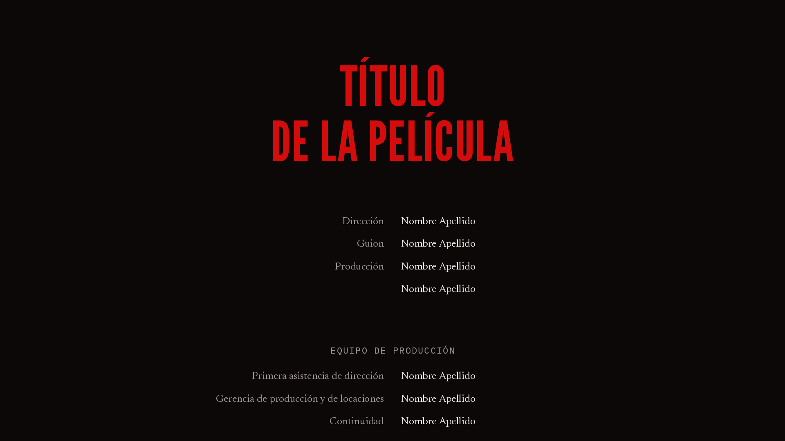

# datitles

Títulos para DaVinci Resolve: créditos que suben, tarjetas de inicio, cintillos y un efecto de
película con halo, grano, viñeta y gate weave. Escribes el texto, sueltas el título en la línea de
tiempo y la animación dura lo que dure el clip.



## qué trae

| En Resolve | Qué hace |
|---|---|
| Titles > Datitles > datitles creditos | créditos que suben de abajo hacia arriba |
| Titles > Datitles > datitles inicio | tarjetas centradas que entran y salen con fade |
| Titles > Datitles > datitles clasico | los créditos en blanco sobre negro, a una columna |
| Titles > Datitles > datitles papel | los créditos en tinta sobre papel crema |
| Titles > Datitles > datitles cintillo | nombre y cargo en el tercio inferior |
| Effects > Datitles > datitles pelicula | halo por canal, grano, viñeta y gate weave |

Los títulos son dos Fuses de Lua (`Fuses/`) envueltos en plantillas de Fusion. La película usa
solo nodos de Fusion. Todo es Lua y nodos nativos (sin DCTL ni OFX), así que corre en Resolve
gratis y en Studio.

## instalar

macOS o Linux:

```sh
git clone https://github.com/donutinit/datitles
cd datitles
./install.sh
```

En Windows copia a mano, dentro de
`%APPDATA%\Blackmagic Design\DaVinci Resolve\Support\Fusion\`:

- los dos archivos de `Fuses\` a `Fuses\`
- la carpeta `Templates\Edit\Titles\Datitles` a `Templates\Edit\Titles\`
- la carpeta `Templates\Edit\Effects\Datitles` a `Templates\Edit\Effects\`

Reinicia Resolve. Los títulos quedan en Effects > Toolbox > Titles > Datitles y la película en
Effects > Toolbox > Effects > Datitles. Si tenías la versión 0.1, borra el
`Templates\Edit\Titles\datitles.setting` suelto (`install.sh` lo hace solo).

Las fuentes son todas de Google Fonts, con licencia OFL:

- créditos, inicio y cintillo: League Gothic, Newsreader e IBM Plex Mono
- clásico: Cormorant y Courier Prime
- papel: Bebas Neue, Lora e IBM Plex Mono

Si no las tienes instaladas, cámbialas en Tipografía.

No va en `.drfx` porque ese paquete solo instala plantillas: los Fuses viven en otra carpeta y no
hay forma documentada de que Resolve los saque del paquete.

## cómo se escriben los créditos

Créditos, inicio, clásico y papel usan el mismo texto, una línea por cosa:

| Escribes | Sale |
|---|---|
| `# Título` | título grande en el color del título; varias líneas `#` seguidas forman un solo título |
| `## Fin` | cierre en display mediano |
| `Dirección \| Nombre Apellido` | fila con el rol y el nombre |
| `\| Nombre Apellido` | solo el nombre, en la columna del nombre |
| `Fotografía e iluminación` | línea centrada en mono, para departamentos y notas |
| `> Gracias a todos` | comentario en la fuente de texto, tal como lo escribes; varias líneas `>` seguidas forman un párrafo |
| línea vacía | separa bloques |

```
# Título
# de la película

Dirección | Nombre Apellido
Guion | Nombre Apellido

> Gracias a todas las personas
> que hicieron posible esta película.

Fotografía e iluminación
Dirección de fotografía | Nombre Apellido
Data manager | Nombre Apellido

## Fin

Ciudad, País
```

Los roles y nombres largos parten línea dentro de su columna. En inicio, cada bloque es una
tarjeta. `ejemplos/ejemplo.txt` trae unos créditos completos para copiar y adaptar.

## créditos

- **Animación.** Con "Todo el clip", el rollo entra por abajo en el primer cuadro y sale por
  arriba en el último: para ir más lento, alarga el clip. Con "Manual" manda el slider Progreso
  (0 a 1), que puedes animar con keyframes.
- **Rollo.**
  - Bordes difuminados: las líneas se desvanecen al entrar y al salir, a lo largo del porcentaje
    del alto que pidas (0 lo apaga).
  - Detener el cierre: el último bloque sube hasta el centro, se queda la pausa que pidas y se va
    con fade. Si quieres que se detengan juntos "Fin" y la ciudad, escríbelos sin línea vacía
    entre ellos.
  - Píxeles enteros: el rollo avanza un número entero de píxeles por cuadro, así cada cuadro es el
    anterior movido y los trazos finos no titilan. La consola dice cuánto debe durar el clip para
    que cuadre.
- **Tipografía.** Las tres fuentes, cada una con su estilo, y Mayúsculas: prendido, los títulos,
  el cierre y los departamentos van en mayúsculas; apagado, salen como los escribes (útil para
  marcas como "iPhone"). Roles, nombres y comentarios nunca se cambian.
- **Medidas.** Filas a dos columnas (rol a la izquierda, nombre a la derecha) o a una (el rol
  chico arriba y el nombre abajo, centrados). El texto se mide en porcentaje del alto del cuadro
  y todo lo demás en múltiplos del texto, así que al cambiar el tamaño se escala todo junto.
- **Colores.** Fondo, título, nombres y cierre, roles y mono. Apaga "Fondo sólido" para usar los
  créditos encima de otro clip.

Para un ritmo de lectura cómodo (unas dos filas por segundo), el Fuse escribe en la consola
(Workspace > Console) cuántos segundos debería durar el clip.

## inicio

Las tarjetas van una tras otra en el mismo clip. Cada una entra con fade, se queda y sale con
fade, encima del clip de abajo (el fondo sólido viene apagado). Fade es la duración de cada fade
en segundos. Con el reparto "Según texto", cada tarjeta dura según lo que tarda en leerse; con
"Igual", todas duran lo mismo. La consola dice cuánto conviene que dure el clip.

Las filas vienen a una columna. `ejemplos/inicio.txt` trae unas tarjetas de ejemplo.

## clásico y papel

Son los créditos con otro look; todos los controles son los mismos. El clásico va en blanco sobre
negro, con Cormorant, Courier Prime y a una columna. El de papel va en tinta sobre crema, con
Bebas Neue, Lora e IBM Plex Mono.

## cintillo

Nombre y cargo en el tercio inferior. El nombre va en display y el cargo en mono, como los
títulos y los departamentos de los créditos. Entra al principio del clip y sale al final: con
"Fade" solo aparece, con "Sube" además sube un poco. En Posición eliges la alineación, el margen
lateral y la altura. Con Mayúsculas apagado, nombre y cargo salen como los escribes.

## película

Un efecto para que los títulos (o todo el cuadro) se vean filmados. Está hecho solo con nodos de
Fusion:

- **Suavidad.** Un desenfoque leve de toda la imagen, para que el texto no se vea tan nítido
  como un gráfico de computadora.
- **Halo.** Las partes que pasan el umbral se difuminan por canal y se suman encima. En película,
  la luz rebota en la base y vuelve a exponer primero la capa roja, por eso el rojo viene más
  fuerte que el verde y el azul casi apagado. Cada canal tiene su tamaño y su fuerza.
- **Grano.** El Film Grain de Fusion, después del halo para que el halo también tenga grano.
  Fuerza, tamaño, aspereza y saturación: en 0 el grano es monocromo y en 1, a color.
- **Viñeta.** Las orillas hacia negro, fuera de una elipse suave. Intensidad, tamaño y suavidad.
- **Gate weave.** El cuadro entero se mueve muy poco, al azar y despacio, como en el proyector.
  La amplitud es en porcentaje del ancho; el zoom justo para que no se vean los bordes sale solo.

Para que todo comparta el mismo grano y el mismo halo, ponlo en un clip de ajuste encima del
metraje y de los títulos. Sobre un título solo funciona mejor con el fondo sólido prendido.

## probar sin Resolve

`dev/preview` simula la parte de la API de Fusion que usan los Fuses. Revisa que los Fuses estén
armados desde `src/` y que todas las plantillas cuadren con su Fuse; luego corre una plantilla con
LuaJIT y dibuja algunos cuadros en PNG con las fuentes instaladas. Necesita `luajit`, Python con
Pillow y numpy, y `fc-match`.

```sh
dev/preview -t ejemplos/ejemplo.txt -s 45
dev/preview -p inicio -t ejemplos/inicio.txt -s 36
dev/preview -p cintillo -s 5 -v "Name=Nombre Apellido" -v Role=Dirección 60
dev/preview -p pelicula -t ejemplos/inicio.txt -s 36 160
```

`-p` elige la plantilla (por omisión, creditos) y `-v ID=VALOR` cambia una entrada, por ejemplo
`-v Rows=1`. La película se prueba encima de los cuadros de otra plantilla sobre negro (`-b`, por
omisión inicio), con una aproximación en numpy: sirve para ver la intención, no para calibrarla.
Si cambias el código, edita `src/` y corre `dev/build`, que arma los archivos de `Fuses/`.

El simulador no reemplaza a Resolve: confirma la maqueta y que las llamadas sigan los ejemplos
del Fuse SDK, no cómo se comporta Fusion de verdad.

## estado

Versión 0.2. Probada con el simulador; falta probarla a fondo en Resolve. Si algo no se ve bien,
abre un issue con tu versión de Resolve y una captura.

## in English

datitles is a family of DaVinci Resolve titles: a rolling end-credits crawl, centered opening
title cards with fades, two alternative credit looks, a lower third and a film-look effect with
per-channel halation, grain, vignette and gate weave. Credits are written as plain text
(`Role | Name`, `# Title`, `## Closing`, plain lines for departments). It ships as two Lua Fuses
plus Edit page templates in a `Datitles` folder; run `./install.sh` on macOS or Linux, or copy
the files into your Fusion folder on Windows. Works on the free version.

## licencia

[AGPL-3.0-only](LICENSE). Copyright (C) 2026 Von Diego.
